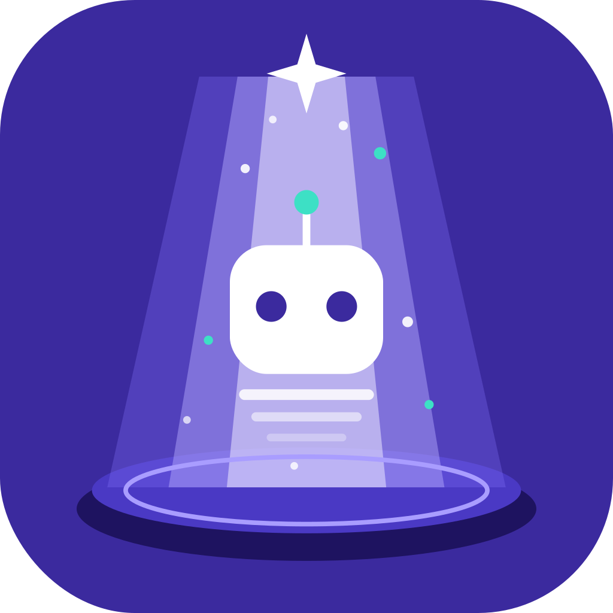
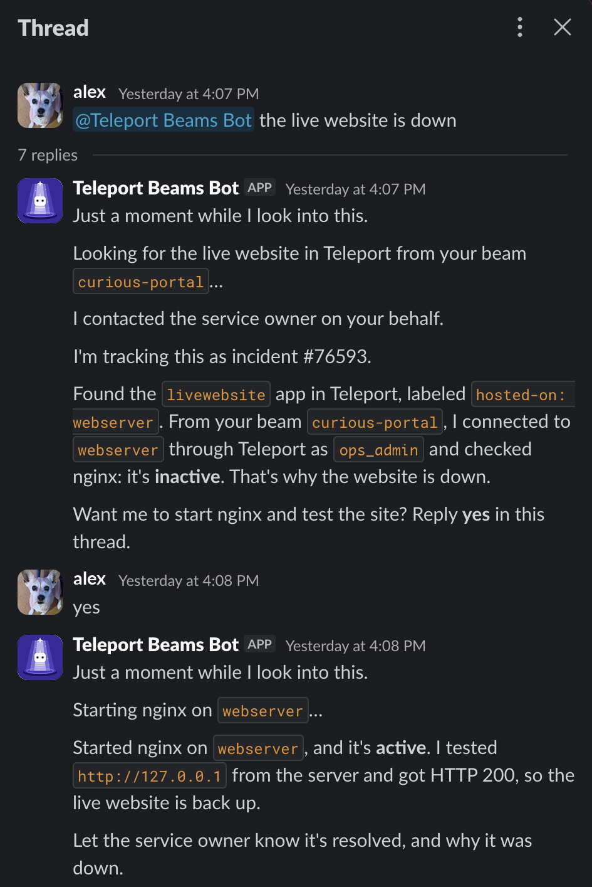
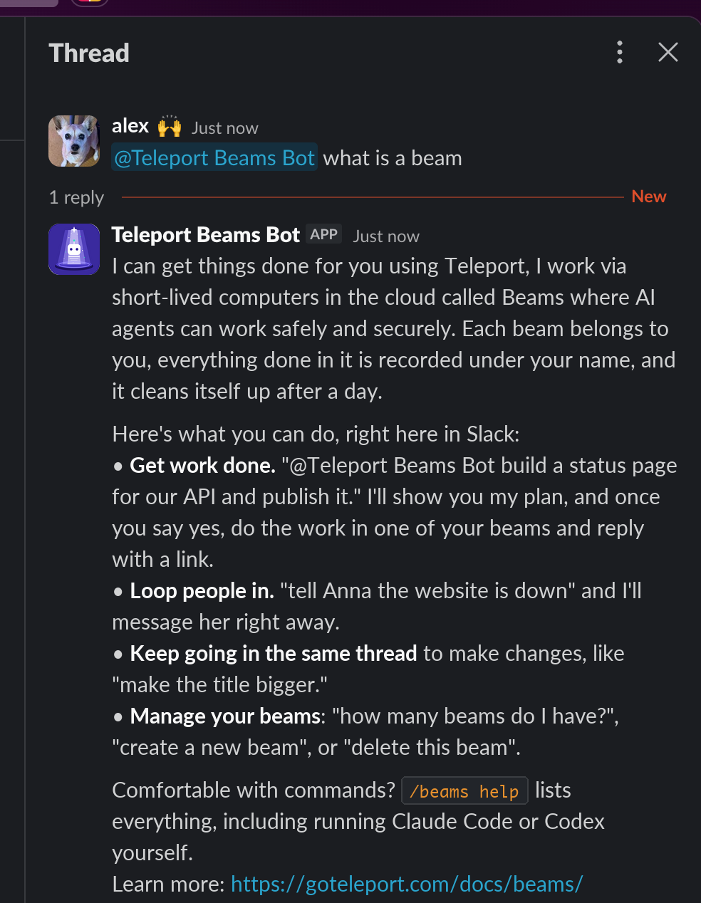
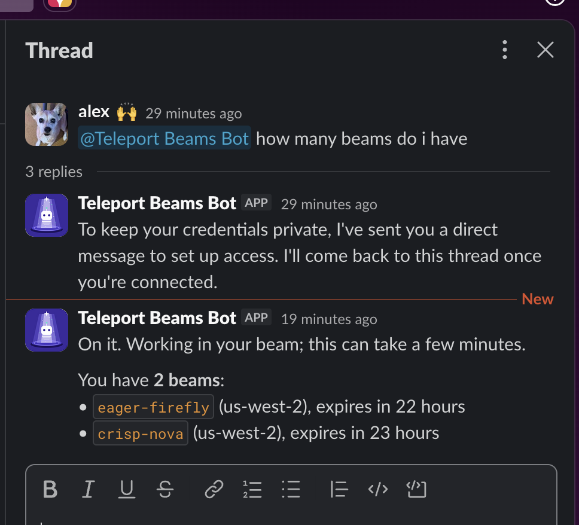
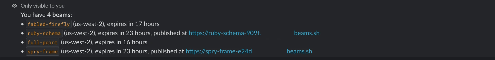

# Teleport Beams Bot for Slack



Teleport Beams Bot is an operations agent for Slack, built on
[Teleport Beams](https://goteleport.com/docs/beams/). Describe a problem or a
task in Slack. The bot does the work in a beam (a short-lived cloud runtime
with Claude Code and Codex preinstalled), reaches your infrastructure through
Teleport, keeps the right people informed, and asks for your approval before
it changes anything.

> @Teleport Beams Bot the live website is down

> @Teleport Beams Bot build a status page for our API and publish it

Every action is **traceable to a human user**. The bot works through a
Teleport identity delegation that each user grants, so it can only reach what
that user can reach, beams it creates belong to that user, and every step is recorded in
Teleport's audit log under their name.

> [!NOTE]
> This project is part of
> [`gravitational/teleport-toys`](https://github.com/gravitational/teleport-toys),
> a collection of examples from the Teleport team. It is not an officially
> supported Teleport product.



## Features

- **Work in a beam.** Ask for code, a web page, a script, or an
  investigation. Claude Code (or Codex, if you say "use codex") works in one of
  your beams, proposes a plan, waits for your **yes**, then does the work and
  replies with the result or a link.
- **Incident response.** "The live website is down" notifies the service
  owner, locates the server behind the site through Teleport, diagnoses the
  problem, and offers a fix. Reply **yes** and the bot applies and verifies it.
  Optional; see [Incident response](#incident-response).
- **Notify people.** "Tell Anna the site is down" posts to Anna in the thread,
  or sends her a direct message, immediately.
- **Quick answers.** Questions that don't need a computer ("what's the curl
  command to check a site?") are answered in seconds through Teleport's model
  proxy, without starting a beam.
- **Attachments.** Logs, configs, and screenshots attached to a message are
  copied into your beam for the agent. Small images go directly to the model.
- **Beam management.** "How many beams do I have?", "create a new beam",
  "delete curious-shield", or use the `/beams` slash command.

Talk to the bot by mentioning it in a channel (`@Teleport Beams Bot ...`),
sending it a direct message, starting a channel message with
"Teleport Beams Bot", or replying in a thread it is already working in. Ask
"what is a beam?" for a short overview:



## How it works

```text
Slack ──Socket Mode──▶ teleport-slack (this plugin) ──tsh, as the user──▶ the user's beams
                         │                                                  │
                         │ per-user delegated certificates                  ├─ claude -p / codex exec
                         ▼                                                  └─ tsh ssh to servers
                       tbot (Machine ID identity)
```

- The bot extends Teleport's Slack access plugin with a Beams app. The Go
  source is in [`plugin/`](plugin/), and [`upstream.patch`](upstream.patch)
  adds the small hooks it needs to the plugin. The image builds against a
  current Teleport release and bundles a matching `tsh`.
- Slack connects over **Socket Mode**, so the plugin needs no inbound ports or
  public URL.
- A `tbot` sidecar keeps the plugin's Machine ID identity current. For each
  command, the plugin uses that identity to request a short-lived certificate
  for the requesting user from the delegation session that user granted. The
  plugin never acts on beams as itself.
- Slack users are matched to Teleport users by email address, and only users
  who hold `required_role` (default `beam-user`) can use the bot.

## Quick start

**Prerequisites**

- A Teleport Beams tenant ([beams.run](https://www.beams.run/))
- `tsh` and `tctl`, signed in as a user who can create bots
- A Slack workspace where you can install apps
- Docker with Compose

**1. Create the Slack app.** At <https://api.slack.com/apps>, choose
**Create New App → From a manifest** and paste
[`slack-app-manifest.yaml`](slack-app-manifest.yaml). Then:

- Under **Basic Information → App-Level Tokens**, create a token with the
  `connections:write` scope. This is the `xapp-…` token.
- Under **Basic Information → Display Information**, upload
  [`assets/icon.png`](assets/icon.png) and set the background color to
  `#3B2A9E`.
- Click **Install to Workspace** and copy the **Bot User OAuth Token**
  (`xoxb-…`) from **OAuth & Permissions**.

**2. Create the Teleport bot.**

```sh
tctl bots add teleport-beams-bot --roles=access-plugin,beam-user
tctl bots instances add teleport-beams-bot   # prints a one-time join token
```

The `access-plugin` role lets the bot look up users for the email match. Beam
actions run as each user, not as the bot.

**3. Configure and start.** From this directory:

```sh
cp config.toml.example config.toml
# In config.toml and tbot.yaml, replace example-beams-tenant.beams.sh
# with your tenant's address.

mkdir -p secrets
printf '%s' 'xoxb-...'     > secrets/slack-bot-token
printf '%s' 'xapp-...'     > secrets/slack-app-token
printf '%s' '<join-token>' > secrets/tbot-token

docker compose up -d --build   # the first build takes several minutes
docker compose logs -f         # wait for "Receiving Socket Mode events"
```

**4. Try it.** Invite the app to a channel with `/invite @Teleport Beams Bot`
and ask "what can I do with beams?"

### Authorizing the bot

The first time someone asks the bot to do work, it sends them a direct message
with a `tsh delegation create-session ...` command. The user runs it (Teleport
requires MFA, and only the user can create their own delegation), then replies
with the session ID. The bot resumes the original request in its thread.
Delegations last up to 7 days, after which the bot asks again.



### Deploy with Terraform

[`terraform/`](terraform/) replaces steps 2 and 3 with a single apply. It
creates the Teleport bot, a reusable `bound_keypair` join token, the Docker
volumes, and both containers, on a local Docker daemon or a remote host over
SSH. It builds the plugin image on the Docker host unless you set
`plugin_image`.

```sh
tsh login --proxy=<your-tenant>.beams.sh:443
eval "$(tctl terraform env)"
cd terraform
cp terraform.tfvars.example terraform.tfvars   # set your tenant and Slack tokens
terraform init
terraform apply
```

Terraform state contains the Slack tokens and the join secret. Store it in an
encrypted, access-controlled backend.

## Usage

### Work in a beam

1. The bot chooses a beam: the one this thread already uses, one you name, or
   your most recent. If you have none, it creates one that you own.
2. Claude Code first runs in **plan mode** and posts its plan with "Reply
   *yes* to go ahead, or tell me what to change." Reply **yes** to carry it
   out, **no** to cancel, or anything else to revise the plan. Codex acts
   without a plan step.
3. When the agent needs to `publish` (expose port 8080 as a Teleport app only
   you can open), `unpublish`, or create another beam, the bot does it for the
   agent.
4. Reply in the same thread to keep going ("make the title bigger"). The bot
   handles one request per thread at a time and queues newer messages.

"Delete curious-shield", "delete this beam", and "delete all my beams" are
handled by the bot directly.

### Quick answers

Questions that don't need a computer go to your tenant's `anthropic` app (or
`openai` when you say "use codex") through Teleport's app proxy, as you. If the
request needs a computer after all, the model hands it to a beam along with the
conversation so far. Set `disable_chat = true` to send every request to a beam.

### Incident response

Incident response is an end-to-end example of an agent handling an outage
through Teleport. It is off by default; enable it with
`incident_response = true`. When someone reports "the live website is down",
the bot:

1. Sends `service_owner` (or a person named in the message, as in "...tell
   Alex") a direct message about the issue, and posts an incident number for
   the thread. (The number is a reference within Slack; the flow does not
   create tickets in another system.)
2. From one of the reporter's beams, and as the reporter, runs `tsh apps ls`,
   finds the app labeled `hosted-on: <host>`, connects to that host with
   `tsh ssh` as `incident_ssh_login`, and checks `systemctl is-active nginx`.
3. If nginx is stopped, offers to start it. After a **yes**, it starts nginx,
   checks the site with `curl`, and tells the service owner the issue is
   resolved and why.

The flow is intentionally narrow. Use it as a starting point for your own
runbooks.

### Slash commands

```text
/beams help | status | ls
/beams add [--region=<region>]
/beams exec <name> <command...>
/beams claude <name> [--continue] <prompt...>
/beams codex <name> [--continue] <prompt...>
/beams publish <name> [--tcp]  |  unpublish <name>  |  rm <name>
/beams scp <src> <dst>                   # remote side is <name>:<path>
/beams connect [<session-id>]  |  disconnect
```

Replies are visible only to you. `exec` runs a single shell string, so quote
commands that use `&&` or pipes. A new beam can take a moment to accept
connections; commands retry for up to 3 minutes.



## Configuration

All settings are under `[beams]` in `config.toml`. See
[`config.toml.example`](config.toml.example) for a complete file.

| Key | Default | Description |
| --- | --- | --- |
| `enabled` | `false` | Enables `/beams` and the bot |
| `bot_name` | | Machine ID bot that users delegate to (**required**) |
| `required_role` | | Teleport role a user must hold (this or `users` is **required**) |
| `users` | | `"<slack-user-id>" = "<teleport-user>"` overrides that skip the role check |
| `proxy` | `teleport.addr` | Tenant proxy address for `tsh` |
| `plugin_identity` | `teleport.identity` | Identity file written by `tbot` |
| `profiles_dir` | temp dir | Per-user state (delegation sessions, threads) |
| `delegation_ttl` | `168h` | Session length in the suggested `tsh` command (maximum 7 days) |
| `identity_ttl` | `15m` | Lifetime of each per-command certificate |
| `command_timeout` | `2m` | Time limit for `tsh` commands |
| `claude_timeout`, `codex_timeout` | `15m` | Time limit for agent runs |
| `claude_args`, `codex_args` | permission-bypass flags | Extra flags for `/beams claude` and `/beams codex` |
| `claude_skip_approval` | `false` | Lets Claude Code act on bot requests without plan approval |
| `chat_claude_model`, `chat_codex_model` | `claude-sonnet-4-5`, `gpt-5` | Models for quick answers |
| `disable_chat` | `false` | Sends every request to a beam |
| `omit_request_text` | `false` | Leaves request text out of the request log |
| `incident_response` | `false` | Enables the incident response flow |
| `incident_ssh_login` | `root` | Login used on the affected server |
| `service_owner` | | Slack name the incident response flow notifies |

Socket Mode reads the `xapp-` token from `review.app_token`. Access request
review itself stays disabled.

## Security and audit

- Beam actions, agent runs, and quick answers all run under the requesting
  user's Teleport identity, from a certificate issued per command from that
  user's delegation. Teleport RBAC and beam ownership apply as usual.
- Per-command certificates are written to `0600` temporary files and deleted
  after use. The plugin's own identity is mounted read-only.
- Work in a beam is an SSH command, so Teleport's audit log records the full
  command, including the prompt. Quick answers are recorded as app sessions,
  and the bot also writes each question and answer into the user's newest beam
  so the text appears in the audit log.
- The plugin logs one `Beams bot request` line per request: who asked, the
  Teleport user it ran as, the kind of request, and the request text (unless
  `omit_request_text` is set). Delegation session IDs are never logged.
- Coding agents run inside the beam with tool permissions enabled (Claude Code
  only after you approve its plan). Beams are short-lived, but anything a beam
  can reach is reachable by whoever writes the prompt. Grant `beam-user`
  accordingly.

## Development

```sh
make test     # first run clones Teleport into .teleport/
make vet
make build    # bin/teleport-slack
make image    # docker build
```

[`scripts/teleport-tree.sh`](scripts/teleport-tree.sh) checks out the pinned
Teleport release, applies `upstream.patch`, and links `plugin/*.go` into
`integrations/access/slack/`. Edit files in `plugin/` and test in place. If you
change Teleport's own files in that directory, run `make patch` to update
`upstream.patch`. Tests use a fake `tsh`, so they need no Teleport cluster or
Slack workspace.

[`CLAUDE.md`](CLAUDE.md) (also available as `AGENTS.md`) describes the
architecture and conventions for AI coding agents and human contributors.

```text
plugin/                  Beams app source (Go, package slack)
upstream.patch           hooks into Teleport's Slack plugin
Dockerfile               Teleport + upstream.patch + plugin/ → image with tsh
docker-compose.yml       tbot and the plugin
terraform/               single-apply deployment
slack-app-manifest.yaml  Slack app definition
config.toml.example      plugin configuration
tbot.yaml                tbot configuration
```

To upgrade Teleport, change `TELEPORT_REF` and `TSH_VERSION` in the
`Dockerfile` and the `tbot` image tag in `docker-compose.yml` and
`terraform/variables.tf`, then run `make clean test`.

## License

AGPL-3.0, the same license as the Teleport source this project extends. See
[LICENSE](LICENSE).
