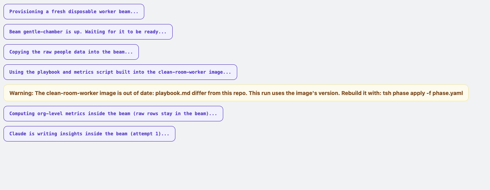

# Customizing Clean Room

How to change what Clean Room measures and how it reports, and how to work on those changes in a Beam without setting things up again each session.

> **Use the sample data only while customizing.** The workspace below is saved with Phase snapshots, and a snapshot keeps everything under `/home`, including any data you put there. Never bring real employee data into a build Beam.

---

## What to change, and where

| To change | Edit | Keep in sync with |
|---|---|---|
| Measures, definitions, thresholds | `worker/playbook.md` (what Claude follows) | `worker/compute_metrics.py` (where the numbers and red/yellow/green cutoffs are calculated) |
| Org names | `ORGS` in `worker/compute_metrics.py` | Your data's `org` values |
| Rating scale (what counts as a top performer) | `TOP` in `worker/compute_metrics.py` | The scale in `worker/playbook.md`, section 3 |
| Minimum group size | `MIN_GROUP` in `worker/compute_metrics.py` | `MIN_GROUP` in `app.py` (the privacy gate) |
| Privacy gate rules | The pattern lists in `app.py` | Section 5 of `worker/playbook.md` |

**After any change in `worker/`, rebuild the worker image** so new runs pick it up:

```bash
chmod -R a+rX worker
tsh phase apply -f phase.yaml
tsh phase ls
```

The `chmod` makes sure the files are readable inside the Beam; the image keeps each file's permissions. If you forget, the app warns you at the start of each run that the image is out of date, and records it in the run receipt.



---

## A saved workspace for customizing (optional)

A Phase snapshot lets you set up a workspace once, work on it over several sessions, and pick up where you left off. This is separate from the `clean-room-worker` image that real runs use.

### Start a workspace

From your laptop, in the repository folder:

```bash
tsh phase add clean-room-dev
```

This creates a Phase called `clean-room-dev` and opens a build Beam. Note the Beam's name from the prompt, then, in a **second** terminal on your laptop, copy the repo in:

```bash
tsh beams scp --recursive . <build-beam-name>:/home/beams/clean-room
```

### Work on it

Inside the build Beam:

```bash
cd ~/clean-room
python3 -m venv .venv
source .venv/bin/activate
pip install flask
CLEAN_ROOM_LOCAL=1 python3 app.py
```

Inside a Beam, practice mode uses the Beam's built-in Claude, so you see real insights on the sample data. To view the app, run `tsh beams publish <build-beam-name>` from your laptop and open the link it prints.

Edit `worker/playbook.md` or `worker/compute_metrics.py`, run again, and repeat.

### Save, stop and come back

| Action | Command (inside the build Beam unless noted) |
|---|---|
| Save and keep working | `tsh phase snapshot` |
| Save and end the session | `tsh phase snapshot --final` |
| Come back later (from your laptop) | `tsh phase edit clean-room-dev` |
| Try an idea without touching the saved workspace | `tsh phase add clean-room-experiment --fork` |

Snapshots save files under `/home`, not running programs. Start the app again after you come back.

### Bring your changes home

When you're happy, copy the changed files back to your laptop:

```bash
tsh beams scp <build-beam-name>:/home/beams/clean-room/worker/playbook.md ./worker/playbook.md
tsh beams scp <build-beam-name>:/home/beams/clean-room/worker/compute_metrics.py ./worker/compute_metrics.py
```

Commit them to your copy of the repo, then rebuild the worker image with `tsh phase apply -f phase.yaml`.

---

## Rules for both images

- **`clean-room-worker`** (built from `phase.yaml`): the toolkit only. It's rebuilt from files in the repo, so anyone can review what's in it. Never add data to `phase.yaml`.
- **`clean-room-dev`** (your snapshot workspace): sample data only. Don't save real data, credentials or keys under `/home`; snapshots keep them.
- Beams that real runs create (`tsh beams add --phase=clean-room-worker`) can't save changes back to the image, so nothing from a run ends up in it.
