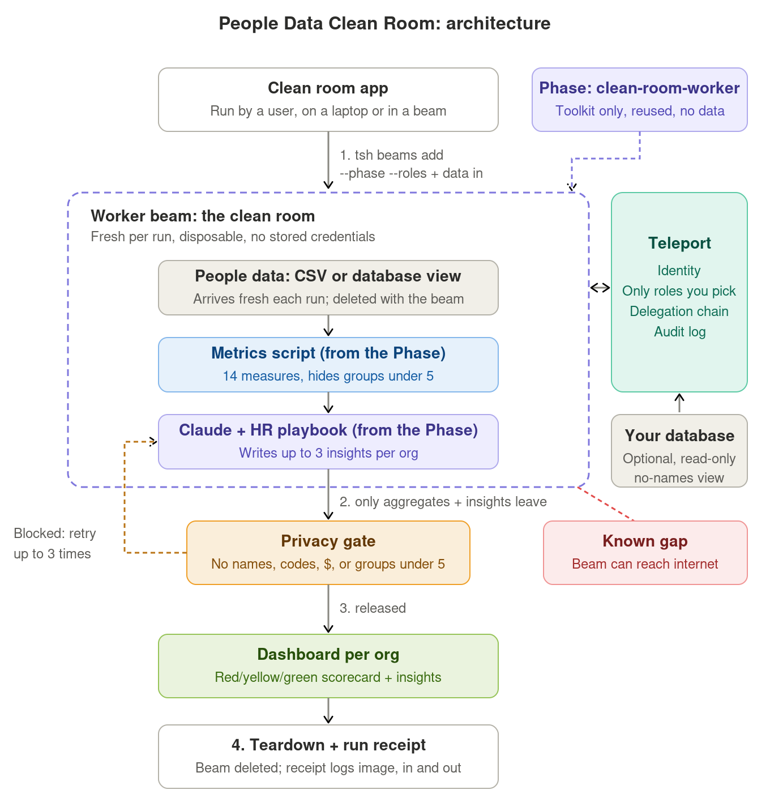
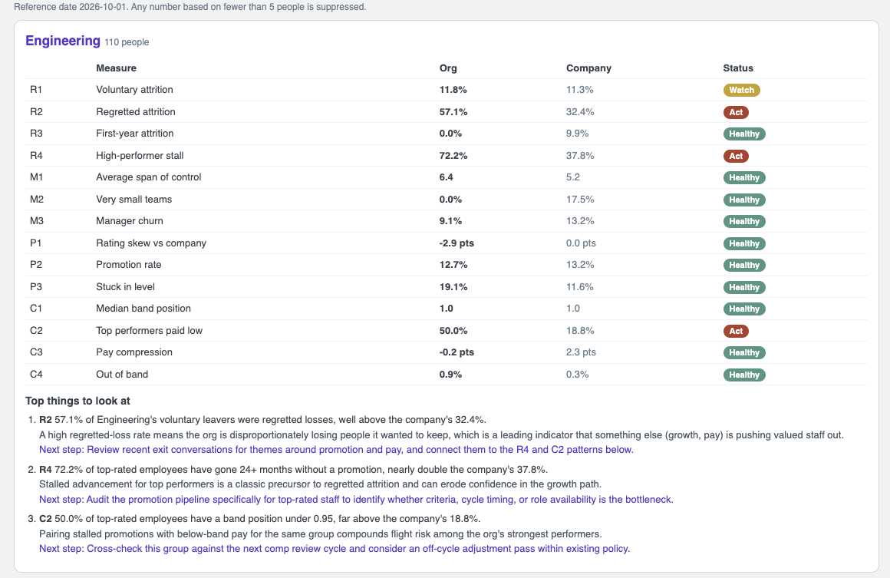
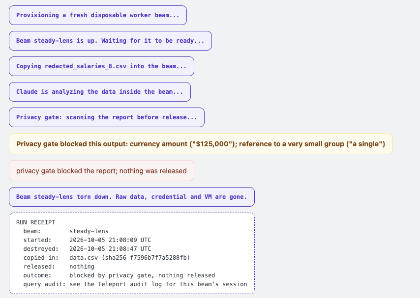
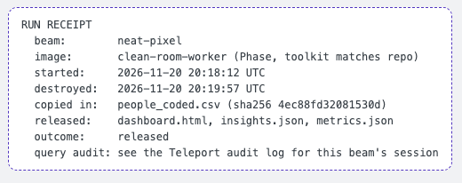
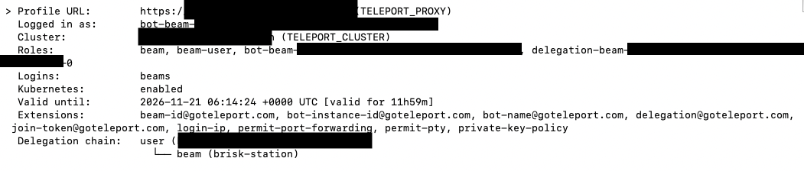
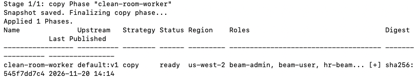
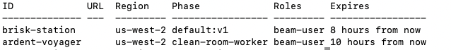

# Clean Room

A People Data Clean Room built on Teleport Beams. Sensitive HR data goes into a disposable Beam. A fixed metrics script and Claude analyze it there, and only privacy-checked, org-level results come back out. The Beam is deleted at the end of every run, and a receipt records what went in, what came out, and when the Beam was destroyed.

All data in this repo is fictional. This is an example, not HR or legal advice; see [Disclaimer](#disclaimer).

## How it works

One click in the web app (`app.py`):

1. **Creates a fresh worker Beam** from the `clean-room-worker` image, with only the Teleport roles you choose. The image is a Teleport [Phase](https://goteleport.com/docs/beams/#building-reusable-images-with-phases) with the metrics script and playbook built in, and no data.
2. **Brings the data in:** copies a sample CSV into the Beam, or pulls a no-names view from your database through Teleport ([CONNECT_DATABASE.md](CONNECT_DATABASE.md)). Data arrives fresh in every run and never goes into the image.
3. **Computes 14 org-health measures inside the Beam** (`worker/compute_metrics.py`). Any number that describes fewer than 5 people is suppressed: a small population, a small count within it (such as 1 leaver), or a small remainder. A company figure is also hidden when subtracting the visible orgs from it would reveal a suppressed one. Raw rows never leave.
4. **Runs Claude inside the Beam** to write up to 3 insights per org, following `worker/playbook.md`.
5. **Checks everything before release.** The app rebuilds the metrics and insights from known orgs, measures and fields only, then the privacy gate checks every string it will show or save. It blocks employee and manager codes, dollar amounts, numbers based on fewer than 5 people, small-group phrases ("the only one," "two engineers"), and SSN, bank and email patterns. It does **not** detect names: keeping names out is the job of the no-names view. Blocked output goes back to Claude inside the Beam with the triggering phrase quoted, up to 3 tries; the browser only sees which rule fired, never the blocked text.
6. **Shows a red/yellow/green dashboard** per org, with suppressed numbers marked "Suppressed (<5)."
7. **Deletes the Beam**, even if something failed or the browser was closed, checks with `tsh beams ls` that it is gone, and prints a **run receipt**: Beam ID, the image it used, whether teardown was confirmed, what went in (with a fingerprint), what came out, and the outcome. If teardown can't be confirmed, the receipt says so and gives the command to remove the Beam.



**The dashboard:** each org gets a red/yellow/green scorecard and up to 3 insights.



**The privacy gate:** with names removed from an 8-person dataset, Claude still wrote a salary that belongs to one person. The gate blocked it, and nothing was released.



**The receipt:** every run ends with a record of the image used, what went in, what came out, and when the Beam was destroyed.



**Scoped roles:** each worker Beam gets only the roles you choose. Here, just `beam-user`, plus the system roles Teleport adds, with a delegation chain back to the person who started it.



## The three buttons

| Button | Purpose |
|---|---|
| **Run Org Health Dashboard** | The full flow on about 300 fictional employees across 5 orgs. |
| **Run naive report (watch the gate)** | Why removing names isn't enough. An 8-person dataset with names removed, and a basic prompt. The report ties salaries to job titles, and with 8 people, each title is one person. The gate blocks it, and nothing is released. |
| **Run Customer ARR Summary** | The same pattern on different sensitive data (customer revenue). Dollar amounts are allowed for this dataset. |

## Requirements

- Python 3 and Flask
- For real runs: `tsh` **18.11.10 or newer**, and a Teleport cluster with Beams and Phases enabled. Claude runs inside each Beam using Beams' built-in inference, so no API key is needed.

  Check with `tsh version`. If your cluster automatically switches you to an older version (the output says "Re-executed from version"), put `TELEPORT_TOOLS_VERSION=18.11.10` in front of each `tsh` and app command below. If you see `unknown long flag '--roles'` or `'--phase'`, your `tsh` is too old.

## Running it

### 1. Set up

```bash
python3 -m venv .venv
source .venv/bin/activate
pip install flask
```

**Practice mode** (no Beams, no Claude; checks the flow and the UI):

```bash
CLEAN_ROOM_LOCAL=1 CLEAN_ROOM_FAKE_AGENT=1 python3 app.py
```

### 2. Build the worker image (once)

```bash
tsh login --proxy=<your-cluster>:443 --user=<you>
tsh phase apply -f phase.yaml
tsh phase ls
```

Wait for `clean-room-worker` to show **ready**. Rebuild it the same way whenever you change anything in `worker/`. If you forget, the app warns you at the start of each run that the image is out of date.



### 3. Run it

```bash
CLEAN_ROOM_PHASE=clean-room-worker CLEAN_ROOM_BEAM_ROLES=beam-user TELEPORT_CLUSTER=<your-cluster> python3 app.py
```

Replace `<your-cluster>` and `<you>` with your own values, without the angle brackets (for example, `--proxy=example.beams.sh:443`).

Then open http://localhost:8080. Each run creates a Beam from the image and deletes it at the end. To watch Beams appear and disappear, run `tsh beams ls` in a second terminal; the Phase column shows which image each Beam used.



**Without the image:** leave out `CLEAN_ROOM_PHASE`, and the app copies the toolkit into each Beam instead. This works, but the image is the recommended setup: its contents are defined in `phase.yaml` and can be reviewed, and runs have fewer steps.

**The app has no login,** so it listens on `127.0.0.1` only by default. Anyone who can reach it can start runs and download reports.

**Running the app inside a Beam instead of your laptop:** start it there the same way, then run `tsh beams publish <beam-id>` to share it through Teleport. If the published link can't reach the app, start it with `CLEAN_ROOM_HOST=0.0.0.0`; Teleport controls who can open the published link.

### Settings

| Environment variable | Default | Purpose |
|---|---|---|
| `CLEAN_ROOM_PHASE` | *(empty)* | The worker image, `clean-room-worker`. **Recommended.** Empty means the toolkit is copied in each run. |
| `CLEAN_ROOM_BEAM_ROLES` | *(empty)* | Roles each worker Beam gets. **Empty means all of your roles**, so set this. `beam-user` is enough for CSV mode. |
| `TELEPORT_CLUSTER` | | Cluster that hosts the worker Beams (shown in the UI) |
| `CLEAN_ROOM_DATA_SOURCE` | `csv` | `csv` or `database`. See [CONNECT_DATABASE.md](CONNECT_DATABASE.md). |
| `CLEAN_ROOM_DB`, `CLEAN_ROOM_DB_USER`, `CLEAN_ROOM_DB_NAME`, `CLEAN_ROOM_DB_VIEW` | see guide | Database settings for `database` mode |
| `CLEAN_ROOM_REFERENCE_DATE` | latest quarter start (database), `2026-10-01` (sample CSV) | Date the "last 12 months" measures count back from, `YYYY-MM-DD`. Must be the first day of a quarter (`01-01`, `04-01`, `07-01` or `10-01`). Anything dated after it is ignored. See [CUSTOMIZING.md](CUSTOMIZING.md). |
| `CLEAN_ROOM_HOST`, `CLEAN_ROOM_PORT` | `127.0.0.1`, `8080` | Where the web UI listens. Only use `0.0.0.0` on a network you control. |
| `CLEAN_ROOM_LOCAL=1` | off | Simulate worker Beams locally. If `claude` is on your PATH and `CLEAN_ROOM_FAKE_AGENT` is off, Claude runs on this machine with only Read, Glob and Grep and no MCP servers. It can't write files or run commands, but it can read any file your user can. |
| `CLEAN_ROOM_FAKE_AGENT=1` | off | Skip Claude and use placeholder insights |

## Customizing it

- **Change the measures, thresholds, org names, rating scale or privacy rules:** see [CUSTOMIZING.md](CUSTOMIZING.md) for what to edit where, and what must stay in sync. Rebuild the worker image afterwards.
- **Work on changes over several sessions:** `CUSTOMIZING.md` also covers a saved workspace using Phase snapshots, with sample data only.
- **Use your own data:** [CONNECT_DATABASE.md](CONNECT_DATABASE.md) covers enrolling a database, building a no-names view, and creating a read-only role.

## Security notes

- **Each Beam gets only the roles in `CLEAN_ROOM_BEAM_ROLES`.** Leave it empty and a Beam inherits all of the user's standing roles.
- **The worker image never holds data.** It's built only from the files `phase.yaml` lists. Data arrives in each run and is destroyed with its Beam. Beams started from the image can't save changes back to it.
- **Never use Phase snapshots with real data.** A snapshot saves everything under `/home` and reuses it in future Beams. Use snapshots only for a customizing workspace with sample data.
- **Beams can currently reach the public internet.** Teleport plans to restrict outbound networking by default in a future release. Until then, the privacy gate controls what the app releases, but can't stop an agent from sending data out on its own.
- **Beams expire after 11 hours.** Clean Room deletes each worker Beam as soon as its run finishes.
- **The no-names view is your main line of defense.** The agent can only leak what it can read.

## Known limitations

- **Claude's output format:** the app asks Claude for JSON and reads the first `{...}` block. Unexpected output fails the run rather than releasing anything.
- **Comparing runs:** the reference date must be a quarter start, so two runs can't be a day apart. Runs on adjacent quarters can still be compared. If only a few people joined, left or were promoted in an org during a quarter, the difference between the two dashboards may say something about them. Release one dashboard per quarter, and limit who can run the app.
- **Timeouts:** each Claude attempt has a 4-minute limit.
- **The worker image stays in the region where it was built.** Beams created from it run in that region.
- **Database mode** follows the Beams documentation but hasn't yet been tested end to end. See [CONNECT_DATABASE.md](CONNECT_DATABASE.md).

## Repository layout

```
app.py                              Flask web app and orchestrator (Beam lifecycle, gate, dashboard)
phase.yaml                          builds the clean-room-worker image (toolkit only, no data)
worker/compute_metrics.py           runs inside the worker Beam; raw data in, aggregates out
worker/playbook.md                  org-health playbook: measures, thresholds, read-out format
data/people_coded.csv               303 active + 56 recent leavers (fictional, no names or SSNs)
data/redacted_salaries_8.csv        8-person dataset for the privacy gate demo
data/customer_arr_summary.csv       customer ARR dataset
database/people_seed.sql            sample tables, no-names view and read-only grant
database/clean-room-reader.yaml     Teleport role for database mode
CONNECT_DATABASE.md                 guide to reading from your own database
CUSTOMIZING.md                      what to change where, and a saved workspace for customizing
assets/                             architecture diagram and screenshots
```

## What the sample data should show

The fictional data has problems planted in it, so you can check a run is working. At the sample's reference date (2026-10-01):

| Org | Red flags | Also visible | Suppressed (a group, count or remainder under 5 people) |
|---|---|---|---|
| Engineering | Regretted attrition (R2), high-performer stall (R4, ~72%), top performers paid low (C2) | Attrition on watch (R1) | C4 |
| Product | Narrow spans (M1), very small teams (M2), manager churn (M3) | | R1, R2, P2, P3, C3 |
| Sales | Attrition (R1), first-year attrition (R3), pay compression (C3) | | R2, R4, M3, C2 |
| Marketing | Rating inflation (P1), promotion rate (P2) | | R1, R2, R4, M3, P3, C3 |
| G&A | None: the healthy comparison org | | R1, R2, M3, P3, C3 |

In the Company column, R2, R4, P2, C2 and C4 are hidden, because with the org figures they would reveal a suppressed number.

## Further reading

- [`worker/playbook.md`](worker/playbook.md): the 14 measures and their thresholds
- [Teleport Beams docs](https://goteleport.com/docs/beams/), including [Phases](https://goteleport.com/docs/beams/#building-reusable-images-with-phases)
- [Beams Database Demo](https://goteleport.com/docs/beams/databases/)

## Disclaimer

Clean Room shows one way to analyze sensitive people data with Teleport Beams. The measures, thresholds and privacy rules are starting points, not recommendations for any specific organization. Before using it with real employee data, review it with your HR, legal, privacy and security teams, and check that it meets the laws and policies that apply to you (for example, data protection, employment and works council requirements).
